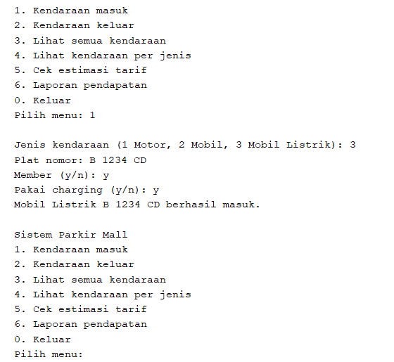
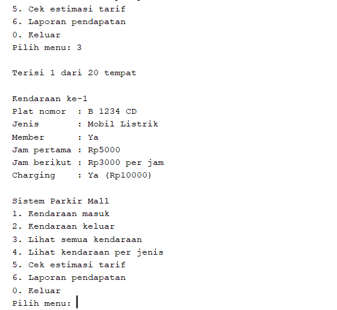
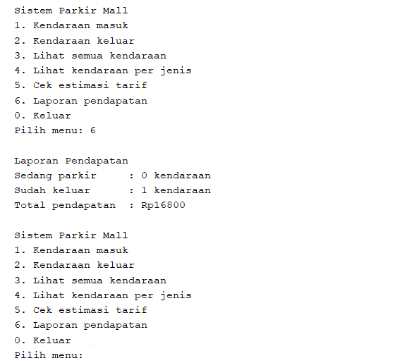

# Sistem Parkir Mall

Program console sederhana untuk mencatat kendaraan yang masuk dan keluar dari area parkir mall, menghitung tarif parkir, dan membuat laporan pendapatan. Dibuat untuk tugas mata kuliah Pemrograman Berorientasi Objek menggunakan Java (Apache NetBeans, Java with Ant).

| | |
|---|---|
| Nama | Annisa Nayzhua Febriyani |
| NIM | 2509116013 |
| Kelas | A |

## Fitur

| Menu | Fungsi |
|---|---|
| 1. Kendaraan masuk | Mencatat kendaraan baru: jenis, plat nomor, status member, dan pemakaian charging (khusus mobil listrik) |
| 2. Kendaraan keluar | Mencari kendaraan berdasarkan plat nomor, meminta lama parkir, lalu menampilkan struk berisi tarif, diskon, dan total bayar |
| 3. Lihat semua kendaraan | Menampilkan semua kendaraan yang sedang parkir |
| 4. Lihat kendaraan per jenis | Menampilkan kendaraan yang sedang parkir sesuai jenis yang dipilih |
| 5. Cek estimasi tarif | Menghitung perkiraan tarif tanpa menyimpan data kendaraan |
| 6. Laporan pendapatan | Menampilkan jumlah kendaraan yang sedang parkir, yang sudah keluar, dan total pendapatan |
| 0. Keluar | Menutup program |

Input yang salah ditangani oleh program, antara lain:

- area parkir penuh (kapasitas 20)
- plat nomor sudah terdaftar atau tidak ditemukan
- lama parkir kurang dari 1 jam
- jenis kendaraan atau pilihan menu tidak valid
- input yang bukan angka

## Aturan Tarif

| Jenis | Jam pertama | Jam berikutnya | Lebih dari 12 jam |
|---|---|---|---|
| Motor | Rp2.000 | Rp1.000 per jam | Flat Rp15.000 |
| Mobil | Rp5.000 | Rp3.000 per jam | Flat Rp40.000 |
| Mobil Listrik | Sama dengan tarif mobil | Sama dengan tarif mobil | Sama dengan tarif mobil |

Ketentuan tambahan:

- Mobil listrik yang memakai charging dikenai tambahan biaya Rp10.000.
- Member mendapat diskon 20 persen dari total tarif, termasuk biaya charging.
- Lama parkir dihitung dalam jam bulat.

## Struktur Class

```
            Kendaraan
            /       \
        Motor       Mobil
                      |
                 MobilListrik

AreaParkir      : menyimpan dan mengelola daftar kendaraan
SistemParkir    : class main, berisi menu program
```

| Class | Keterangan |
|---|---|
| Kendaraan | Class induk. Menyimpan plat nomor, status member, dan lama parkir, serta menghitung diskon |
| Motor | Turunan Kendaraan dengan tarif motor |
| Mobil | Turunan Kendaraan dengan tarif mobil |
| MobilListrik | Turunan Mobil dengan tambahan biaya charging |
| AreaParkir | Menyimpan kendaraan dalam `ArrayList<Kendaraan>`, mencatat pendapatan, dan menampilkan struk |
| SistemParkir | Menampilkan menu dan membaca input pengguna dengan Scanner |

## Penerapan Konsep OOP

**Inheritance**

| Jenis | Penerapan |
|---|---|
| Single | `Motor extends Kendaraan` |
| Multilevel | `Kendaraan` → `Mobil` → `MobilListrik` |
| Hierarchical | `Motor` dan `Mobil` sama-sama turunan langsung dari `Kendaraan` |

**Polymorphism: method overriding**

| Method | Di-override di |
|---|---|
| `getJenis()` | Motor, Mobil, MobilListrik |
| `hitungTarif(int jam)` | Motor, Mobil, MobilListrik (MobilListrik memanggil `super.hitungTarif(jam)` lalu menambah biaya charging) |
| `tampilkanInfo()` | Motor, Mobil, MobilListrik (masing-masing memanggil `super.tampilkanInfo()`) |

Semua kendaraan disimpan dalam `ArrayList<Kendaraan>`. Saat `hitungTarif()` atau `tampilkanInfo()` dipanggil, method yang dijalankan adalah milik objek aslinya (Motor, Mobil, atau MobilListrik).

**Polymorphism: method overloading**

| Class | Method |
|---|---|
| Kendaraan | Constructor `Kendaraan(String platNomor)` dan `Kendaraan(String platNomor, boolean member)` |
| Kendaraan | `hitungTarif()`, `hitungTarif(int jam)`, dan `hitungTarif(int jam, boolean member)` |
| AreaParkir | `tampilkanDaftar()` dan `tampilkanDaftar(String jenis)` |

**Percabangan dan perulangan**

| Konsep | Lokasi |
|---|---|
| if else | `hitungTarif(int jam)` di Motor, Mobil, dan MobilListrik; `hitungDiskon()` dan `tampilkanInfo()` di Kendaraan; `cariKendaraan()`, `keluarkanKendaraan()`, dan `tampilkanDaftar()` di AreaParkir; validasi input di SistemParkir |
| switch | Pemilihan menu di `main()` |
| for | `cariKendaraan()`, `tampilkanDaftar()`, dan `tampilkanDaftar(String jenis)` di AreaParkir |
| while | Menu utama di `main()`, `inputAngka()` (mengulang input yang bukan angka), dan `inputLamaParkir()` (mengulang input kurang dari 1 jam) |

## Cara Menjalankan

1. Buka project `SistemParkir` di Apache NetBeans.
2. Klik kanan project, lalu pilih **Run**.
3. Pilih menu dengan mengetik angka di panel Output.

## Contoh Hasil

Contoh berikut memakai mobil listrik milik member dengan charging, parkir selama 3 jam.

**Kendaraan masuk**



**Lihat semua kendaraan**



**Laporan pendapatan setelah kendaraan keluar**



Rincian perhitungan tarifnya:

| Komponen | Hitungan | Hasil |
|---|---|---|
| Tarif mobil 3 jam | 5.000 + 2 x 3.000 | Rp11.000 |
| Biaya charging | | Rp10.000 |
| Tarif sebelum diskon | 11.000 + 10.000 | Rp21.000 |
| Diskon member 20 persen | 20% x 21.000 | Rp4.200 |
| Total bayar | 21.000 - 4.200 | Rp16.800 |
